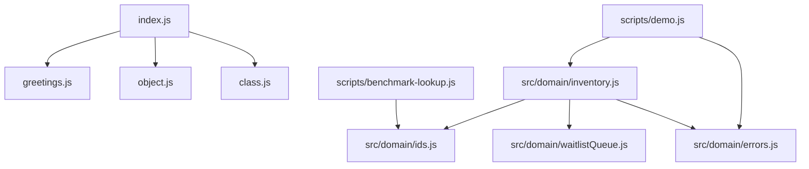
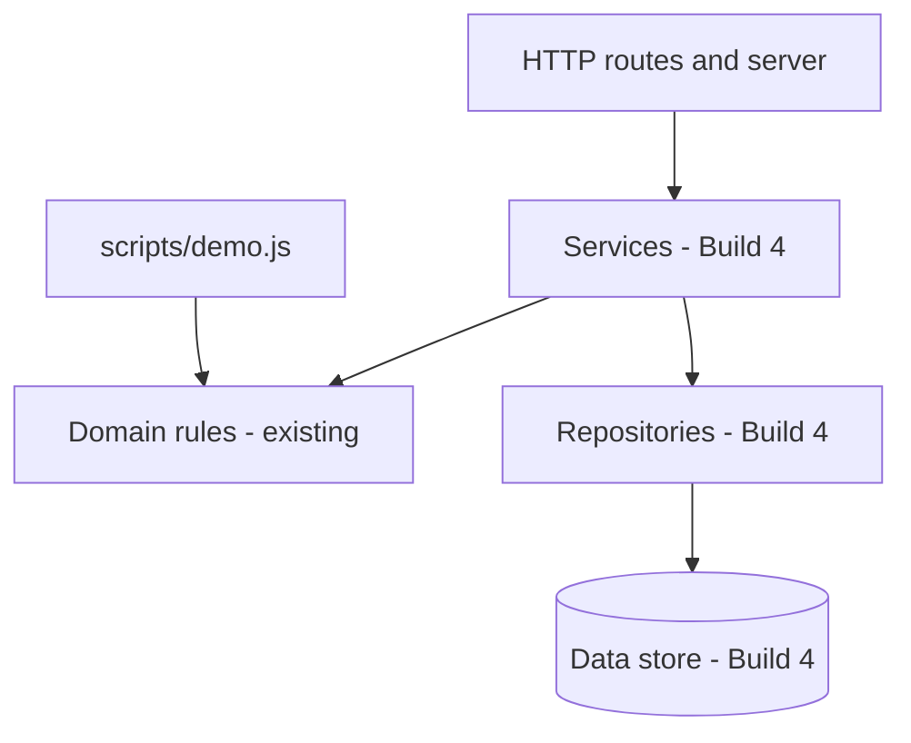
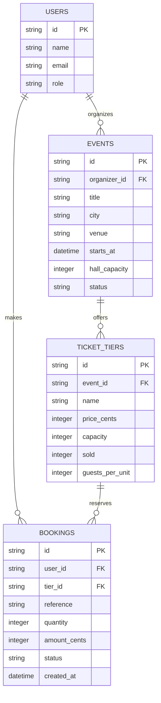
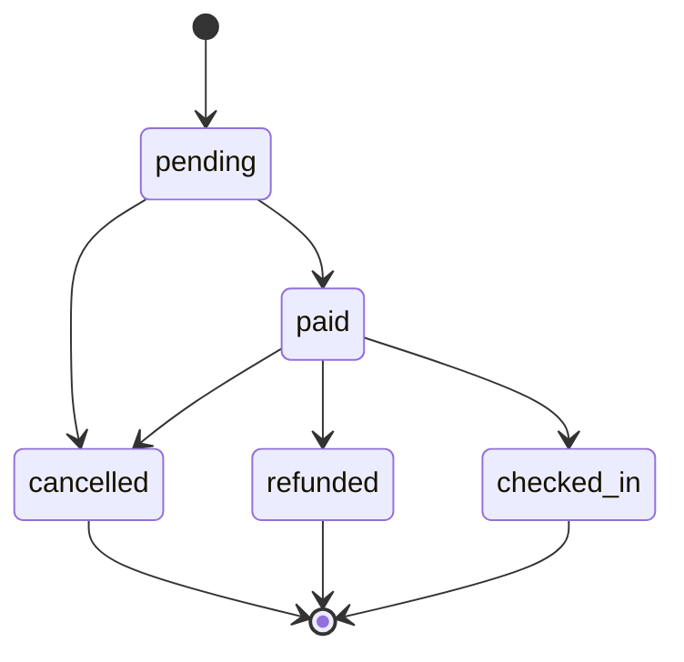

# Build 1 architecture

## Module relationships

The entry point is a small JavaScript exercise. The ticket-booking demo and
benchmark are separate scripts that use the domain modules.

## Responsibilities

- **Entry point:** `index.js` composes greeting functions, a sample booking
  map, and a counter instance, then writes their results to the terminal.
- **Domain:** `src/domain/inventory.js` validates inputs and applies event,
  ticket-tier, booking, cancellation, and waitlist rules. `DomainError`
  represents expected invalid operations with a stable error code.
- **Identifiers:** `src/domain/ids.js` uses Node's `node:crypto` module for
  UUIDs and booking references.
- **Waitlist:** `src/domain/waitlistQueue.js` implements a FIFO linked-list
  queue. Enqueue, dequeue, peek, and size access are O(1).
- **Scripts:** `scripts/demo.js` exercises domain behavior; the benchmark
  compares searching an array with looking up a key in a `Map`.

## In-memory data

`createStore()` creates Maps for events, ticket tiers, bookings, bookings by
reference, and per-tier waitlists. A demo run creates a fresh store, so its
data does not persist after the process exits.

`object.js` separately exports a pre-populated Map for the introductory
`index.js` example. It is not the same store created by the domain demo.

There is no HTTP layer, browser interface, or persistent database in this
build.

## Build 3: Layered architecture

The existing domain modules remain the home of business rules. Build 3 adds
the HTTP boundary and documents the service and repository layers that Build 4
will introduce.

- **Routes and server** may translate HTTP requests and responses; they may
  not contain business rules or access data directly.
- **Services** may coordinate domain rules and repositories; they may not
  depend on HTTP details or call routes.
- **Domain rules** may validate and apply business rules; they may not perform
  I/O or depend on services, repositories, or routes.
- **Repositories** may read and write data; they may not make business
  decisions or call services, rules, or routes.
- **Data store** holds persisted data; it may not call application layers.

## Build 3: Data model

This model documents the planned application entities. Build 3 still uses the
existing in-memory `Map` store; users, authentication, and a persistent
database are not implemented yet.

Ticket-tier capacity counts sellable units. `guests_per_unit` converts those
units to attendee places, so a Couple Pass counts as two places and a table
tier counts as the number of guests it admits. `hall_capacity` limits the
total attendee places allocated across an event's tiers.

## Build 3: Booking life cycle

The state machine defines legal status changes only. Payment, refunds, and
seat-release side effects are implemented in later builds.

