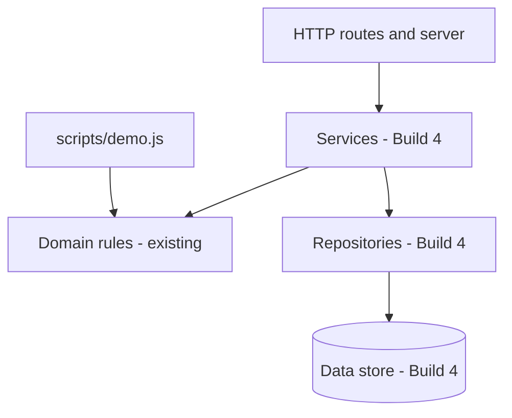
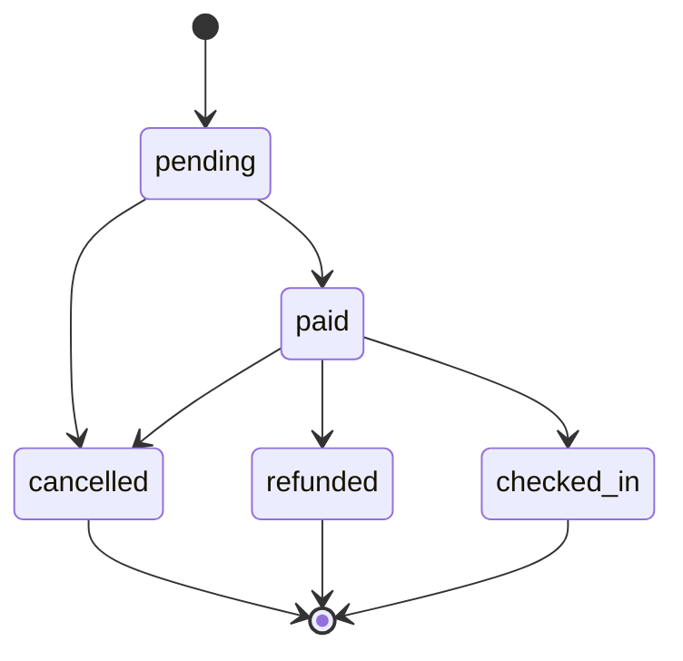

# Build 3: Architecture, state machine, server skeleton

*Week 6 of the course. Starts from the finished state of Build 2.*

## Goal

Document how the existing ticketing domain fits into a layered application,
define the booking state transitions, and add a small Node.js HTTP server with
a health endpoint and safe static-file serving. This is a server skeleton, not
the ticketing API; event and booking API routes arrive in Build 4.

## Deliverables

- `docs/architecture.md` preserves the Build 1 module map and adds a layered
  architecture diagram, the event/tier/booking data model (including the
  planned user entity), and the booking life-cycle state diagram.
- `src/domain/bookingStateMachine.js` defines allowed booking transitions and
  rejects illegal transitions with `INVALID_TRANSITION`.
- `src/http/router.js` matches HTTP methods and paths, including `:params`.
- `src/http/app.js` handles `/health`, JSON errors, and static files from
  `public/` without allowing paths to escape that directory.
- `src/config.js` reads the port from `PORT`, defaulting to `3000`, and
  `src/server.js` starts the HTTP server.
- `public/index.html` gives the server a small static file to serve. It is not
  the attendee or organizer interface; the frontend arrives in Build 6.
- Built-in Node.js tests cover state transitions, routing, HTTP health, error
  responses, static files, and path traversal.

## Architecture boundary

Keep `src/domain/` independent of HTTP and filesystem concerns. The HTTP layer
may translate requests and responses, but it must not duplicate event, tier,
capacity, booking, search, or sorting rules. Build 3 draws the intended layers;
Build 4 introduces the service and repository implementations.



## Booking life cycle

The state machine describes legal status changes only. It does not implement
payment, refunds, or seat-release side effects in this build.



Allowed transitions:

| From | To |
| --- | --- |
| `pending` | `paid`, `cancelled` |
| `paid` | `checked_in`, `refunded`, `cancelled` |
| `cancelled`, `refunded`, `checked_in` | none; these states are final |

## Keep the inventory demo intact

The existing demo is a regression check for more than single tickets. Keep
`scripts/demo.js` working and preserve its sample event and ticket levels:

- General, VIP, and Red Carpet
- Couple Pass, one sellable unit for two attendees
- Emerald Table for 4, Sapphire Table for 6, and Diamond Table for 10
- The 150-attendee hall limit, unallocated capacity, capacity reallocation
  example, bookings, cancellation, and waitlist walkthrough

Do not move these domain rules into HTTP handlers or replace the demo with a
server startup script. The demo remains available as `npm run demo`.

**Current demo note:** `npm run demo` exits successfully and prints the tier
and hall totals, but its two General waitlist attempts currently return
`NOT_SOLD_OUT` because General still has seats available. Build 3 must preserve
the existing demo; do not describe those attempts as a successful waitlist
offer.

## Run and verify

Requires Node.js 22.13 or newer. From this project directory:

```powershell
node index.js
npm run demo
npm run benchmark
npm test
npm start
```

With the server running, open `http://localhost:3000/` for the static page and
`http://localhost:3000/health` for the health response. Set `PORT` to use a
different port.

### Done when

- `node index.js`, `npm run demo`, `npm run benchmark`, and `npm test` still
  work; the demo still shows all ticket levels and its hall-capacity totals.
- Every permitted booking-state transition succeeds, and every other
  transition fails with a `DomainError` whose code is `INVALID_TRANSITION`.
- The router matches method/path pairs and extracts `:params` without putting
  business rules in route handlers.
- `GET /health` returns `{"status":"ok"}`; unknown `/api` paths and malformed
  JSON return JSON errors with a consistent shape and no stack trace.
- The server serves files under `public/` and rejects traversal attempts.
- `npm start` uses `PORT` when set and otherwise listens on port `3000`.

## Implementation map

| Path | Build 3 responsibility |
| --- | --- |
| `docs/architecture.md` | Extend the existing module map with layers, data model, and booking states |
| `src/domain/bookingStateMachine.js` | Allowed booking states and transitions |
| `src/http/router.js` | Method/path matching and route parameters |
| `src/http/app.js` | Health endpoint, error responses, and safe static serving |
| `src/config.js` | Port configuration |
| `src/server.js` | Start the HTTP server |
| `public/index.html` | Static-file serving target |
| `test/bookingStateMachine.test.js` | Allowed and rejected transition tests |
| `test/router.test.js` | Router matching tests |
| `test/httpApp.test.js` | HTTP, static-file, and error tests |
| `scripts/demo.js` | Existing ticket-tier and capacity regression demo; preserve it |

## AI prompt

Read `README.md`, `docs/user-stories.md`, `docs/build-2.md`, this file,
`docs/architecture.md`, and the files in `src/domain/`, `scripts/`, and `test/`
before making changes. Use plain JavaScript ES modules, Node.js 22.13 or newer,
and built-in Node modules only. Do not change working Build 1 or Build 2
behavior.

1. Extend `docs/architecture.md`; do not replace the existing module map or
  responsibility notes. Add a Mermaid layer diagram, a data model for users,
  events, ticket tiers, and bookings that matches the current fields
  (including `hallCapacity`, `guestsPerUnit`, and booking status), and the
  booking state diagram above. Mark users as a planned entity: do not claim
  authentication or persisted user records exist yet.
2. Add `src/domain/bookingStateMachine.js` with `canTransition(from, to)` and
   `assertTransition(from, to)`. Allowed moves are pending to paid/cancelled
   and paid to checked_in/refunded/cancelled. Terminal states are
   cancelled/refunded/checked_in. Illegal moves throw `DomainError` with
   `INVALID_TRANSITION`.
3. Add a small router in `src/http/router.js` that matches method plus path and
   supports `:params`. Add a Node `http` server in `src/http/app.js`:
   `GET /health` returns `{"status":"ok"}`; unknown `/api` routes return JSON
   404; malformed JSON returns JSON 400; errors use
   `{"error":{"code":"...","message":"..."}}`; static paths are confined
   to `public/`. Never send a stack trace to the client.
4. Add `src/config.js` and `src/server.js`. Use `PORT` or default to `3000`,
   and add an `npm start` script without removing existing scripts.
5. Add a minimal `public/index.html` and built-in `node:test` coverage for
   every allowed and rejected state transition, route matching, a real health
   request on a free port, malformed JSON, unknown API routes, and static-path
   traversal.
6. Preserve `src/domain/inventory.js`, its capacity and reallocation rules,
   all existing tests, and `scripts/demo.js`. In particular, keep the General,
   VIP, Red Carpet, Couple Pass, Emerald Table for 4, Sapphire Table for 6,
   Diamond Table for 10, and 150-person hall example working. The HTTP skeleton
   must not replace or rewrite the terminal demo.

When done, list every changed file and any rule you were unsure about. Run the
checks in this guide and record the prompt, result, mistakes, and corrections
in `docs/ai-log.md`.

## Definition of done

The Definition of done in [user-stories.md](user-stories.md) applies to every
story in this project. Build 3 adds architecture and server foundations; it
does not add new product stories.

[All milestones](milestones.md) · [Build 2](build-2.md)