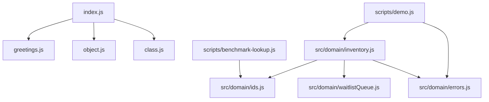
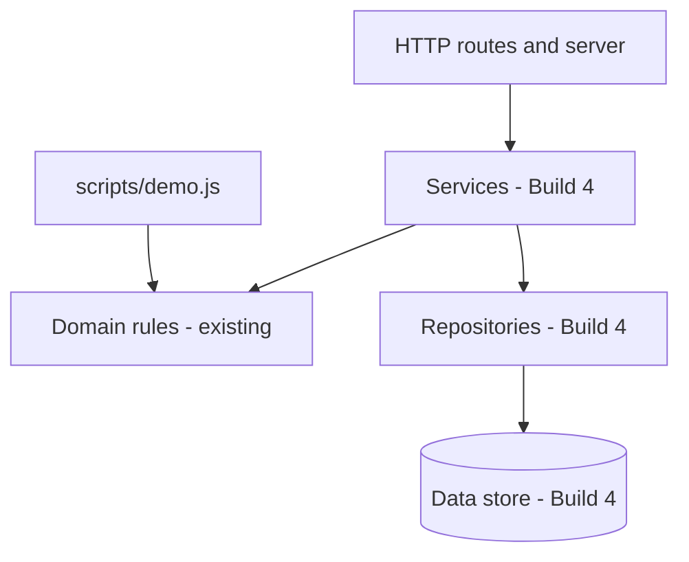
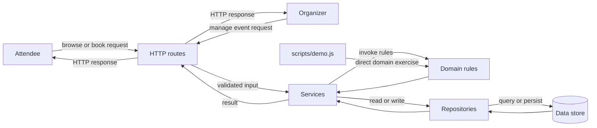
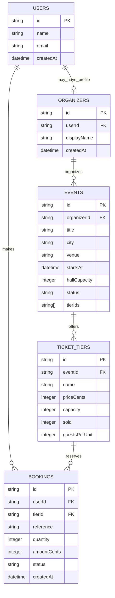
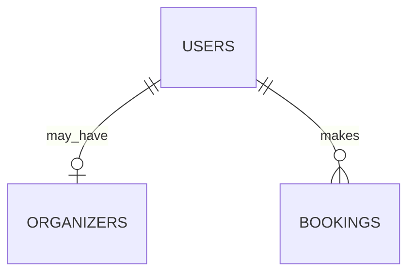
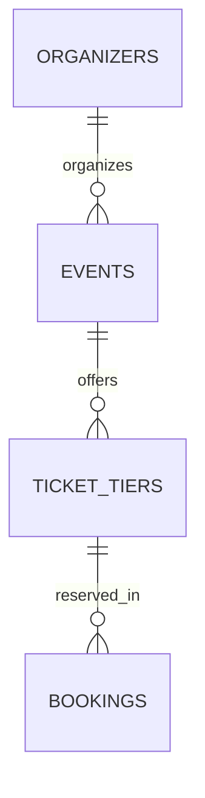
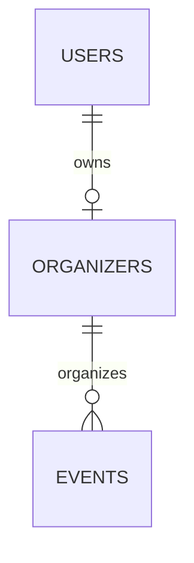
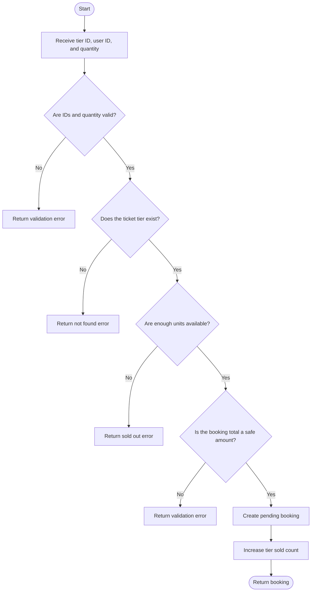
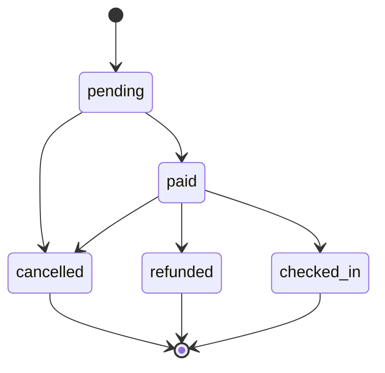

# Build 1 architecture

## Module relationships

The entry point is a small JavaScript exercise. The ticket-booking demo and
benchmark are separate scripts that use the domain modules.

## Responsibilities

- **Entry point:** `index.js` composes greeting functions, a sample booking
  map, and a counter instance, then writes their results to the terminal.
- **Domain:** `src/domain/inventory.js` validates inputs and applies event,
  ticket-tier, booking, cancellation, and waitlist rules. `DomainError`
  represents expected invalid operations with a stable error code.
- **Shared validation:** `src/domain/validation.js` centralizes reusable
  record, text, whole-number, date, and ticket-quantity checks for the domain
  and application services.
- **Identifiers:** `src/domain/ids.js` uses Node's `node:crypto` module for
  UUIDs and booking references.
- **Waitlist:** `src/domain/waitlistQueue.js` implements a FIFO linked-list
  queue. Enqueue, dequeue, peek, and size access are O(1).
- **Scripts:** `scripts/demo.js` exercises domain behavior; the benchmark
  compares searching an array with looking up a key in a `Map`.

## In-memory data

`createStore()` creates Maps for events, ticket tiers, bookings, bookings by
reference, and per-tier waitlists. A demo run creates a fresh store, so its
data does not persist after the process exits.

`object.js` separately exports a pre-populated Map for the introductory
`index.js` example. It is not the same store created by the domain demo.

There is no HTTP layer, browser interface, or persistent database in this
build.

## Build 3: Layered architecture

The existing domain modules remain the home of business rules. Build 3 added
the HTTP boundary; Build 4 now connects it to event and booking services and an
in-memory repository. SQLite persistence and atomic booking are introduced in
Build 5.

**Chart description:** The HTTP routes and server form the entry point for
client requests. They pass application work to services, which coordinate
domain rules and repositories. Repositories access the data store. The demo
script is separate from the HTTP path and calls the domain rules directly.
Arrows show allowed dependencies; lower layers do not call back into upper
layers.

- **Routes and server** may translate HTTP requests and responses; they may
  not contain business rules or access data directly.
- **Services** may coordinate domain rules and repositories; they may not
  depend on HTTP details or call routes.
- **Domain rules** may validate and apply business rules; they may not perform
  I/O or depend on services, repositories, or routes.
- **Repositories** may read and write data; they may not make business
  decisions or call services, rules, or routes.
- **Data store** holds persisted data; it may not call application layers.

### Data flow diagram

The HTTP request moves inward through the application layers. Responses return
to the client through the HTTP boundary; domain rules do not depend on HTTP.

**Chart description:** Attendees and organizers send browse, booking, or event
management requests to the HTTP routes. Routes pass validated input to a
service. The service invokes domain rules and uses repositories for data
access; repositories query or persist data in the store. Results travel back
through the service and HTTP layer as responses. The demo bypasses the HTTP
layer and exercises the domain directly.

## Build 3: Data model

The diagram below is the planned relational model. Build 3 still uses the
existing in-memory `Map` store: it has no persisted user or organizer records,
authentication, or relational database. In the current implementation,
`event.organizerId` and `booking.userId` are stored as strings and are not
validated against user or organizer records.

`ORGANIZERS` is a planned profile associated with a user; organizer
authentication and profiles do not exist yet. Event ownership is shown through
that planned profile. Ticket-tier capacity counts sellable units.
`guestsPerUnit` converts sellable units to attendee places, so a Couple Pass
counts as two places and a table tier counts as the number of guests it admits.
`hallCapacity` limits the total attendee places allocated across an event's
tiers. The `tierIds` array is how the current in-memory event links to tiers;
the relational model represents that relationship through `TICKET_TIERS.eventId`.

**Chart description:** The ER diagram shows users making bookings and
optionally having an organizer profile. Organizer profiles own events; events
offer ticket tiers; bookings reserve a tier. `PK` marks each entity's primary
key and `FK` marks a planned foreign-key relationship. These relationships
describe the intended relational model and are not enforced by the current
in-memory store.

### User ER diagram

One user may have an organizer profile and may make many bookings. A user
without an organizer profile can still be an attendee.

**Chart description:** A user may make zero or many bookings and may have zero
or one organizer profile. The profile is optional so attendee accounts do not
need organizer capabilities.

### Event ER diagram

Each event belongs to one organizer profile and offers ticket tiers. A tier may
be referenced by many bookings.

**Chart description:** Each event is associated with an organizer and can offer
multiple ticket tiers. A tier can appear in multiple bookings, while each
booking refers to one tier.

### Organizer ER diagram

An organizer profile belongs to one user and can organize multiple events.
This is a planned relationship; the current event record only stores an
`organizerId` string.

**Chart description:** An organizer profile belongs to one user and may
organize multiple events. This isolates organizer-specific event management
from the user's attendee bookings.

## Build 3: Booking life cycle

The state machine defines legal status changes only. Payment, refunds, and
seat-release side effects are implemented in later builds.

### Booking creation flowchart

This flow describes the current `bookTickets` domain operation, not an HTTP
endpoint. Booking API routes are not implemented yet.

**Chart description:** The booking operation validates the supplied tier,
user, and quantity, looks up the tier, and checks its remaining sellable units.
If any check fails, it returns an error without creating a booking. If the
booking total is valid, it creates a `pending` booking, increases the tier's
sold count, and returns the booking.

**Chart description:** A booking starts as `pending`. It can be paid or
cancelled; a paid booking can be checked in, refunded, or cancelled. The final
states (`cancelled`, `refunded`, and `checked_in`) have no outgoing
transitions.

`pending` bookings may become `paid` or `cancelled`. A `paid` booking may
become `checked_in`, `refunded`, or `cancelled`. `cancelled`, `refunded`, and
`checked_in` are terminal states; no further transitions are allowed.
